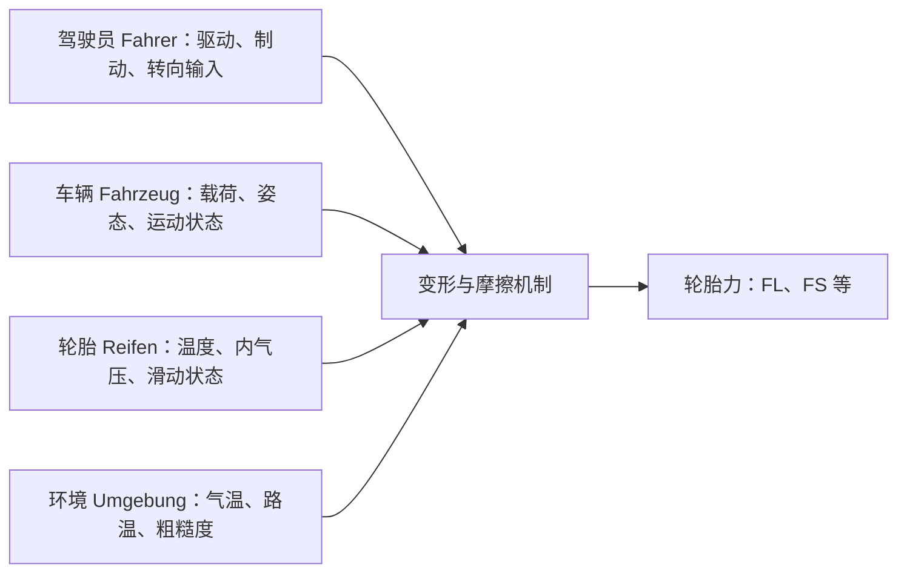
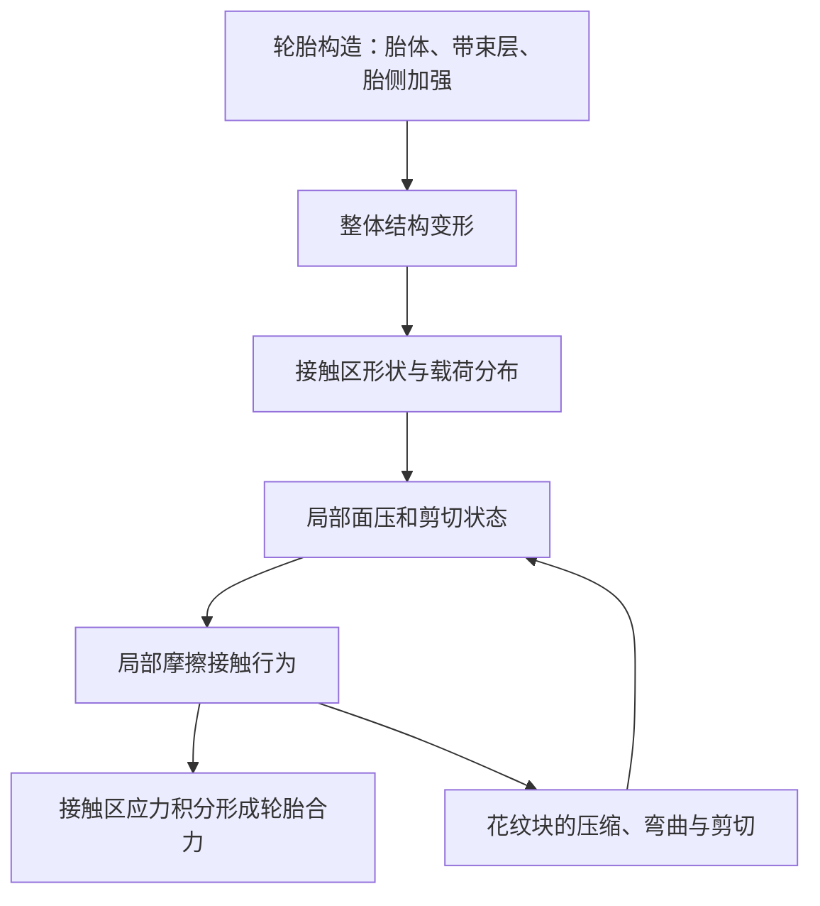

# Fahreigenschaften I · Kapitel 2 Reifenkräfte
# 原 PDF 第 1–10 页德中对照教学笔记

来源：`FE_1_Kap_2_Reifenkräfte_WS26_27(2).pdf`，共 124 页。Universität Stuttgart / Institut für Fahrzeugtechnik Stuttgart；正文页脚：Dr.-Ing. Dipl.-Math. Jens Neubeck，12.10.2026。本笔记核对日期：2026-10-20。

**页码规则：** P1 指 PDF 阅读器中的第 1 页；P3–P8、P10 的原页脚编号与 PDF 序号相同。P1、P2、P9 未印数字，仍按 PDF 顺序保留，绝不跳号。本批只讲 P1–P10，未将其余 114 页标为已读。

**阅读规则：** “课件内容”是对当前文件文字与图像的核对；“教学补充”是辅助解释、模型或例题，不代表教授在该页给出这些公式。前 10 页没有独立的计算公式；P7 的符号和 P8 的力箭头不等于公式推导。德语解释句为本笔记整理，除引号中的短语外不宣称逐字引文。

**版本规则：** 仓库原有笔记引用文件名结尾 `(1).pdf`。本次实际读取 `(2).pdf`，SHA-256：`00bafe73bfbbb48bd0b3e10d62b8490058b727639036c1f9558b8312b9948f29`。没有取得旧文件的二进制进行比较，因此不宣称两个版本完全相同。原 PDF 未随本笔记提交到 GitHub。

## 本批导航

| PDF 页 | 德语主题 | 中文目标 | 原页有何图示 |
|---|---|---|---|
| 1 | Fahreigenschaften I / Reifenkräfte | 明确课程与本章问题 | 研究所楼宇封面 |
| 2 | Allgemeines | 建立基础知识入口 | 蓝白分隔页 |
| 3 | Aufgaben und Anforderungen | 区分轮胎做什么与做得好不好 | 轮胎和轮辋照片 |
| 4 | Reifenaufbau | 识别十个结构名称与位置 | 分层剖视图和胎圈放大图 |
| 5 | Reifenlatsch | 理解有限接触区及影响因素 | 受载轮胎接地照片 |
| 6 | Entstehung der Reifenkräfte | 把宏观受力与微观变形联系起来 | 文字页 |
| 7 | Einflussfaktoren | 读懂驾驶员—车辆—轮胎—环境框图 | 输入、机制、输出框图 |
| 8 | Längs- und Seitenkräfte | 在正确坐标系分解轮胎力 | 立体轮胎图和俯视箭头图 |
| 9 | Deformationsmechanismen | 从基础进入变形机制 | 蓝白分隔页 |
| 10 | Globale und lokale Deformation | 区分结构变形与花纹块变形 | 文字页 |

## P1 · Vorlesung Fahreigenschaften I — 汽车行驶特性 I

### 课件内容与德中对照

| Deutsch | 中文 | 如何理解 |
|---|---|---|
| Institut für Fahrzeugtechnik Stuttgart | 斯图加特车辆技术研究所 | 课程所属机构 |
| Vorlesung | 大学讲授课程 | 这是讲义封面 |
| Fahreigenschaften I | 汽车行驶特性 I | 研究车辆如何响应驱动、制动、转向和道路输入 |
| Kap. 2 Reifenkräfte | 第 2 章：轮胎力 | Reifen 的复数/词干与 Kräfte（力的复数）组成复合词 |

**图意：** 主图是研究所楼宇照片，右侧蓝色圆形放置课程名和章名；它不是力学示意图，没有力箭头、试验数据或公式。

### 教学补充：这一章为什么重要

**DE:** Der Reifen überträgt die für Beschleunigen, Bremsen und Lenken erforderlichen Kräfte auf die Fahrbahn.

**中：** 发动机和制动器首先产生转矩；车辆能否加速、减速或改变方向，取决于轮胎接触区能传递多大的力。发动机功率很高，并不保证湿滑路面上的实际加速度很高。

**汽车实例：** 车辆在冰面上大油门起步，轮速迅速上升而车速增长有限。要解释这个现象，既要看驱动转矩，也要看轮胎和路面之间的传力能力。详细滑移定义属于后续内容，本页不提前规定符号。

**本页抓手：** 后面看到“车辆运动变化”，追问一句：是哪一个轮胎力分量，通过哪一块接触区实现的？

## P2 · Reifenkräfte – Allgemeines — 轮胎力：基础知识

**课件内容：** 本页只有章节标题，属于分隔页。Allgemeines 在这里指概述或基础知识，不是一个新的力学机制。

**图意：** 蓝白背景和大圆形延续封面设计，没有曲线、轮胎结构标注或计算题。

**教学补充：** 接下来先建立四个问题：轮胎承担什么任务？内部有什么结构？与地面在哪里接触？接触区怎样产生纵向和侧向力？这是后续讨论摩擦和变形的共同语言。

**汽车实例：** 同样踩刹车，冷胎、热胎、干地、湿地可能有不同表现。仅说“摩擦力”还不够，需要先认识材料、结构和接触状态。

**本页抓手：** 这是知识路线入口；没有需要背诵的新公式。

## P3 · Hauptaufgaben und Hauptanforderungen — 主要任务与主要要求

### 课件内容：两个列表不能混为一谈

| 类型 | Deutsch | 中文 |
|---|---|---|
| Hauptaufgaben des Reifens | Übertragung von Kräften zwischen Fahrzeug und Fahrbahn | 在车辆和路面之间传递力 |
| 主要任务 | Federn und Dämpfen | 弹性缓冲与阻尼减振 |
| Hauptanforderungen an den Reifen | Sicherheit | 安全性 |
| 主要要求 | Emission | 排放／环境影响 |
| 主要要求 | Komfort | 舒适性 |
| 主要要求 | Wirtschaftlichkeit | 经济性 |

**DE:** Aufgaben beschreiben die Funktion; Anforderungen beschreiben die Qualität und die Zielkonflikte dieser Funktion.

**中：** Aufgabe 问“它要做什么”；Anforderung 问“它要做到什么程度”。轮胎要传力，这是任务；要在多种工况下安全传力，这是要求。

**原图：** 右侧是叠放的轮胎与一只装有轮胎的轮辋，标注来源 `www.tyresystem.de`。照片展示实物，不是抓地力比较试验；不能从外观读出摩擦系数。

### 教学补充：Federn 与 Dämpfen 的差别

轮胎受压时产生形变并储存能量，卸载时能恢复一部分，这是弹性作用。橡胶在变形与恢复过程中还会耗散机械能并发热，这是阻尼作用。轮胎是悬架之外的一层弹性与阻尼环节，但不能据此认为轮胎能替代悬架减振器。

用于理解的线性模型（**不是本页原公式**）：

$$F_\mathrm{Feder}=c\,z,\qquad F_\mathrm{Dämpfer}=d\,\dot z.$$

这里写的是阻力大小关系；若写入运动方程，方向应与所选位移或速度正方向相匹配。$c$ 为刚度，单位 N/m；$d$ 为阻尼系数，单位 N·s/m；$z$ 为相对形变，单位 m。真实轮胎有非线性、频率和温度依赖，不能只用两个常数覆盖所有工况。

**汽车实例：** 车轮压过短小路面接缝，胎侧和胎冠的变形可以减小冲击；回弹过程中的耗能又会减少振动。过大的结构刚度可能使冲击更直接地传向车身。

“Emission”本页没有进一步列项。教学上可以联系滚动噪声、磨耗颗粒，以及滚动阻力带来的能耗影响；这些是解释维度，不能冒充原页的完整分类或法规要求。“Wirtschaftlichkeit”可联系寿命、购置和使用成本；“Sicherheit”可联系制动、侧向导向和承载。设计通常要折中，本页没有给出任何一种轮胎在四项指标上的排名。

**本页抓手：** 弹性是储能与恢复，阻尼是耗能；“任务”与“要求”是两层问题。

## P4 · Reifenaufbau — 轮胎结构

### 原图十个编号：位置、中文与功能

| 编号 | 原文 | 中文 | 教学解释：看图时应定位在哪里 |
|---|---|---|---|
| 1 | Lauffläche | 胎面 | 最外侧有花纹、与路面接触的区域；胶料与花纹影响接触行为 |
| 2 | Gürtelabdecklage | 带束覆盖层 | 胎面下方、钢带束层外侧；帮助约束胎冠结构，功能随具体设计变化 |
| 3 | Stahlgürtel | 钢带束层 | 胎冠下的增强层，增强并稳定胎冠，分配载荷 |
| 4 | Karkasse | 胎体帘布层 | 轮胎结构骨架，沿胎侧延伸到胎圈区域，承担结构拉力 |
| 5 | Innerliner | 气密内衬层 | 轮胎内表面，减缓气体渗透；不是图中的钢带束层 |
| 6 | Seitenwand | 胎侧 | 胎面侧边至胎圈之间的侧部区域，能够明显弯曲变形 |
| 7 | Verstärkerstreifen | 加强条／加强层条带 | 胎圈附近的局部加强结构，图中右侧放大图标出多个部位 |
| 8 | Kernreiter | 胎圈填充胶／三角胶 | 胎圈芯上方的填充和过渡区域，影响局部刚度 |
| 9 | Wulstkern | 胎圈芯 | 胎圈内的高强度环状骨架；右侧放大图显示芯部钢丝截面 |
| 10 | Reifenwulst | 胎圈 | 与轮辋配合的整个底部区域；范围比胎圈芯更大 |

**原图怎么读：** 左图是轮胎分层剖视图，来源 Goodyear Dunlop；应先从胎面 1 向内看 2、3，再沿 4 向胎侧和胎圈看。右图来源 auto technik，放大 6–10 区域，尤其展示胎圈芯 9 内部由多根钢丝构成的截面。右图是局部放大，不是第二种完全不同的轮胎。

### 教学补充：把零件放进一条传力路径

道路作用于胎面，载荷通过橡胶和增强结构传到胎圈、轮辋与轮毂。充气压力与胎体结构共同建立承载状态，不能把轮胎想成只有实心橡胶承重，也不能说“只有空气承重、结构不受力”。

**DE:** Die Karkasse bildet das tragende Gerüst; der Stahlgürtel verstärkt vor allem den Kronenbereich.

**中：** Karkasse 是结构骨架；Stahlgürtel 主要增强胎冠区域。两者位置、走向和功能重点不同，不能互换名称。

**汽车实例：** 转弯时胎面接地，轮辋受车辆侧向载荷约束，胎侧可以产生侧向挠曲；即使轮辋姿态变化不大，胎面接地位置和局部应力也会改变。这正是 P10 全局结构变形的前置概念。

**辨词：** Wulstkern 是胎圈内部的“芯”，Reifenwulst 是整个胎圈区域；Kernreiter 是芯附近的填充胶，名字有 Kern 也不等于金属胎圈芯。

**本页抓手：** 至少能在图上区分 3 与 4、9 与 10。仓库旧记录中 3／4 曾混淆；本次没有新作答，复测仍待完成。

## P5 · Reifenlatsch — 接地印痕／轮胎接触区

### 课件内容与德中对照

**DE:** Beim Kontakt zwischen Reifen und Fahrbahn entsteht eine Kontaktfläche: der Reifenlatsch.

**中：** 轮胎与路面接触形成一个有限面积的区域，称为 Reifenlatsch，中文常译接地印痕或接触斑。

原页列出影响接触区形态的四组因素，全部保留：

| Deutsch | 中文 | 教学解释 |
|---|---|---|
| Reifendimensionen, Reifenaufbau, Reifendruck | 轮胎尺寸、结构、胎压 | 同一载荷下，几何尺寸、结构柔度和充气状态共同决定变形 |
| Fahrbahneigenschaften | 路面特性 | 路面纹理、局部形状等会改变实际接触 |
| relative Orientierung des Rades zur Straße: Sturz, Lenkwinkel, Vorspur … | 车轮相对路面的姿态：外倾、转向角、前束等 | 车轮怎样倾斜、怎样指向，会影响接触形态和应力 |
| aus dem Fahrzustand resultierende Horizontal- und Normalkräfte | 工况产生且需要轮胎传递的水平力与法向力 | 载荷及驱动、制动、转弯共同改变接触区 |

原页核心结论是车辆与路面之间的力通过接地印痕传递。此处讨论轮胎接触传力，不是说空气阻力等非接触外力也经过轮胎传入车身。

**原图：** 右侧照片中，轮胎底部受载后压在灰色水平面上，接触附近不再保持完美圆弧。照片用于说明有限接触区；它没有给出接触压强的颜色分布，也不能读出面积数值。

### 术语拆解

- **Sturz**：外倾角，可在车辆前视图中理解为车轮相对竖直方向的倾斜。
- **Lenkwinkel**：车轮转向角；讨论哪个轴、哪个角度时需按课程后续定义确认。
- **Vorspur**：前束，属于俯视图中的车轮指向关系；不是外倾角。
- **Normalkraft**：垂直路面的法向力，不是“正常的力”。
- **Horizontalkräfte**：本处指沿路面方向的切向分量，包含纵向和侧向。

### 教学补充公式：面积、面压与载荷

$$F_N=\int_A p(x,y)\,\mathrm dA,\qquad \bar p=\frac{F_N}{A}.$$

$p(x,y)$ 是局部接触压强，单位 Pa = N/m²；$\bar p$ 是接触区平均压强；$F_N$ 单位 N；$A$ 单位 m²。积分表达“每一小块承担的法向力相加”。这不是本页给出的公式，而是把“力通过接触面传递”写成数学表达。

**算例：** 假定某轮 $F_N=4000$ N，已知平均接触压强 $\bar p=250000$ Pa，则 $A=0.016$ m² = 160 cm²。若进一步把形状粗略视为宽 20 cm 的矩形，则长约 8 cm。矩形和均匀平均值都是教学假设，真实印痕并非规则矩形。

不要把轮胎内气压 $p_i$ 与地面每一点的 $p(x,y)$ 混为一谈。估算 $A\approx F_N/p_i$ 需要忽略结构等影响，只能给出数量级，不能证明接触压强处处等于胎压。

**汽车实例：** 装载后某车轮的法向载荷增加，接触区通常会发生变化；改变胎压也会改变变形和压强分布。但“接地面积更大”不能单独推出“最大抓地力一定按面积同比增加”。

**本页抓手：** 接地印痕是分布受力区，不是几何上的一个点；内气压、局部接触压强、平均接触压强是三个不同概念。

## P6 · Entstehung der Reifenkräfte — 轮胎力怎样形成

### 课件内容：完整保留三层逻辑

| 原页关键词／论点 | 中文说明 |
|---|---|
| Längs- und Seitenführung; Reaktionskräfte | 轮胎力实现纵向与侧向导向，与加速、减速、转弯的受力需求有关 |
| Beschleunigungs-, Verzögerungs- und Zentrifugalkräfte | 原页用加速、减速与离心相关作用描述行驶工况 |
| Reibungskräfte sowie Schubspannungskräfte | 物理上涉及接触摩擦与剪切应力传力 |
| Abgleitvorgänge und elastische Reifenmaterialeigenschaften | 接触区的相对滑动过程、轮胎材料的弹性性质共同参与 |
| Profilelementdeformationen; Seitenwand, Reifenschulter | 花纹单元会变形，胎侧、胎肩等整体结构也会变形 |
| Reib- und Deformationsmechanismen | 后续把影响轮胎力的效应分成摩擦机制与变形机制讨论 |

**原图：** 本页是文字页；没有摩擦曲线、刷子模型图或已标定的滑移范围。

### 教学补充：不要把“离心力”误读为另一股地面外力

在地面近似惯性参考系中，车辆转弯需要指向弯心的合外力，轮胎侧向力提供主要贡献。在随车旋转的非惯性系中，可以引入向外的离心惯性力表达平衡。两种说法采用不同参考系；不能在地面系中把向心需求与离心惯性力同时当成两股真实外力相加。

同样，轮胎对地面和地面对轮胎的力是一对作用与反作用，分别作用在不同物体上，不会在“车辆受力图”里互相抵消。

### 从花纹块变形到合力

想象一个橡胶块：下表面暂时贴住地面，上表面随轮胎结构发生相对位移，橡胶便承受剪切。只要接触区还能维持局部黏着，就可以通过弹性剪切传力；不需要先出现肉眼可见的整块打滑。随着工况变化，接触区中可以同时存在黏着区和局部滑动区。

**DE:** Elastische Verformung ermöglicht Schubspannungen auch in haftenden Bereichen des Kontakts.

**中：** 局部黏着区域也能借弹性形变建立剪切应力。

辅助表达（**本页未给出**）：

$$F_L=\int_A\tau_L(x,y)\,\mathrm dA,\qquad F_S=\int_A\tau_S(x,y)\,\mathrm dA.$$

$\tau_L,\tau_S$ 为接触面切向应力分量，单位 Pa，积分后是 N。摩擦力与剪切应力积分描述相互关联，不能把同一接触力重复计成“摩擦力 + 完全独立的剪切力”。

**汽车实例：** 正常转弯没有明显轮胎尖叫，车辆仍然有侧向加速度，说明仍有侧向力。不能以“没有明显打滑”推断“没有轮胎侧向力”。

**宏观数量级：** 假定 1500 kg 车辆以 15 m/s 绕 50 m 半径稳态转弯，忽略横坡等影响，所需侧向合力约为 $m v^2/R=6750$ N。这是所有轮胎侧向力的合计需求，不是每只轮胎都承担 6750 N，也不能不加条件地平均分配。

**本页抓手：** 车辆动力学告诉你“需要多少力”，接触摩擦与弹性变形解释“轮胎如何形成和限制这股力”。

## P7 · Einflussfaktoren — 多因素输入如何变成轮胎力

### 课件内容与原框图逐项核对

原页指出轮胎力来自驾驶员与车辆的相互作用，并取决于许多内部、外部因素。左侧绿色区域包围驾驶员、车辆、轮胎、环境；箭头指向中间的变形与摩擦机制，再输出轮胎力。

| 原图框 | 图中实际符号 | 中文解释及确定性 |
|---|---|---|
| Fahrer | $M_A,M_B,\delta_L$ | 驾驶员输入；按汽车动力学语境，前两者为驱动、制动转矩；$\delta_L$ 与转向输入有关，具体角度定义须后续核对 |
| Fahrzeug | $F_N,\gamma,\alpha,\beta,\ldots$ | 法向载荷以及车轮／车辆运动和姿态参数；$\gamma$ 常指外倾角、$\alpha$ 常指轮胎侧偏角、$\beta$ 常指车辆侧偏角，原页未逐一定义 |
| Reifen | $T_{surf},T_{comp},v_G,p_i,\ldots$ | 表面温度、胶料／轮胎内部温度相关量、滑动速度相关量、内气压；其中 $T_{comp}$、$v_G$ 的精确定义仍以课程后文为准 |
| Umgebung | $T_{air},T_{track},\text{Rauhigkeit},\ldots$ | 空气温度、路面温度、粗糙度；Rauhigkeit 是原图拼写 |
| Deformations- und Reibungsmechanismen | 中间机制框 | 结构和局部变形、接触摩擦把输入条件联系到输出力 |
| Reifenkräfte | $F_L,F_S,\ldots$ | 纵向力、侧向力及未在本页展开的其他分量 |

**符号纪律：** 图中列变量并不等于图中定义了变量。尤其不能把 $\delta_L$ 擅自固定为“方向盘角”或“道路车轮角”，也不能把 $\alpha$ 与 $\beta$ 当成同一个角。常用含义只帮助入门，符号正负号与精确定义后续需要核对。

### 自制读图示意（重绘逻辑，不是原图截图）

**教学补充：** 原图是影响关系概览，不是参数已经给定的数值模型。它没有告诉我们某参数变化 10% 会让力变化多少，也不表示实际车辆中不存在反馈。

**汽车实例：** 同样的刹车踏板输入，冷胎与热胎、干地与湿地、不同轮载下，能够形成的轮胎力不同。驾驶员给定的是输入，接触机制决定实际能传递的力。

**本页抓手：** 不要只用“驾驶员踩多深”解释制动力；至少同时问载荷、轮胎状态和路面条件。

## P8 · Radfestes Koordinatensystem — 车轮固定坐标系中的力

### 课件内容与德中对照

**DE:** Reifenkräfte werden häufig in einem radfesten, in die Fahrbahnebene projizierten Koordinatensystem beschrieben.

**中：** 轮胎力常用相对车轮固定、并投影到路面平面内的坐标系描述。

**DE:** Längs- und Seitenkräfte beruhen auf denselben Deformations- und Reibungsmechanismen.

**中：** 纵向力与侧向力来自相同类型的变形和摩擦机制，名称反映方向分量的区别。

| 原页符号／术语 | 中文 | 图中读法 |
|---|---|---|
| $F_L$ / Längskraft | 纵向力 | 沿车轮在路面上的纵向方向 |
| $F_S$ / Seitenkraft | 侧向力 | 在路面内垂直于上述纵向的方向 |
| radfest | 相对车轮固定 | 随车轮转向而改变方位；此处不是随胎面材料绕车轴滚动的坐标系 |
| Fahrbahnebene | 路面平面 | 讨论沿路面的两个切向分量，法向分量另行考虑 |

**原图怎么读：** 左下是立体轮胎及路面平面的示意，绿色箭头标出 $F_L$ 和 $F_S$。右下俯视图中，虚线轮胎轮廓相对纸面倾斜，$F_L$ 沿该轮廓的纵向，$F_S$ 沿横向。因此不能简单说“纸面向上永远是纵向、纸面向右永远是侧向”。原图没有完整规定以后每个量的正负号。

### 教学补充：车轮坐标与车身坐标的区别

假设只做平面旋转：车身 $x$ 向前、$y$ 向左，车轮相对车身逆时针转角为 $\delta$；轮胎纵向正方向沿车轮向前，侧向正方向朝车轮左侧。则：

$$F_x=F_L\cos\delta-F_S\sin\delta,$$
$$F_y=F_L\sin\delta+F_S\cos\delta.$$

**这些是自定上述正方向后的教学公式，不是 P8 印出的公式，也不自动等同于教授后文的符号约定。** 它们说明车轮纵向力在车身坐标系里也可能有侧向分量。

**算例：** 自定 $\delta=10^\circ,F_L=1000$ N，$F_S=0$，则 $F_x\approx985$ N，$F_y\approx174$ N。174 N 是坐标转换得到的车身侧向分量，不意味着原本 $F_S=0$ 的条件被改变。

**汽车实例：** 前轮打角时驱动或制动，轮胎纵向力的方向跟随车轮；分析整车运动时，需要先变换到统一车身坐标系，才能把四个轮胎力相加。

**进一步理解：** 同一接触区同时承担驱动／制动和转向。为说明能力限制，可在“各向同性、单一有效摩擦系数”的简化假设下写 $\sqrt{F_L^2+F_S^2}\lesssim\mu F_N$。这是附加的摩擦圆近似，不是本页结论；真实轮胎的组合滑移、载荷敏感性和方向差异不能由它完整表达。这里先记住：两个方向的传力能力相互关联。

**本页抓手：** 先问“哪个坐标系”，再谈“纵向还是侧向”；分量不同不等于机制互不相关。

## P9 · Deformationsmechanismen — 变形机制章节入口

**课件内容：** 标题为 Reifenkräfte – Deformationsmechanismen，中文为“轮胎力：变形机制”。蓝白分隔页，无正文、数据图和公式。

**教学补充：** 到这里已知道轮胎接触区传力。下一步要回答“在同样的路面条件下，轮胎结构和花纹块为何会改变传力表现”。Mechanismus 在这里是作用机制，不应直译为一套机械装置。

**汽车实例：** 结构较柔的胎侧与较硬的胎侧，面对相同侧向载荷时变形可不同；区别来自轮胎本体，不只是地面摩擦条件。

**本页抓手：** 接下来分清两个尺度：整个轮胎结构，以及接地印痕内的花纹单元。

## P10 · Globale und lokale Deformation — 全局与局部变形

### 课件内容：三条主线

1. 除摩擦接触传力（reibschlüssige Kraftübertragung）外，胎面与路面之间的力传递还受轮胎弹性变形特性影响。
2. 分为 Reifenstrukturdeformation (global)，即轮胎整体结构变形，以及 Profilelementdeformation (lokal)，即花纹单元局部变形。
3. 全局变形主要由结构构造决定；局部变形改变接地印痕中的局部面压，并与摩擦机制相互作用。

### 德中对照与尺度比较

| 比较项 | Global：Reifenstrukturdeformation | Lokal：Profilelementdeformation |
|---|---|---|
| 中文 | 轮胎结构整体变形 | 胎面花纹单元局部变形 |
| 关注对象 | 胎体、带束层、胎侧等组合结构 | 接触区内的具体橡胶花纹块 |
| 原文结构词 | Karkasse, Gürtellagen, Seitenwandverstärkungen | Profilelemente, Latsch, lokale Flächenpressung |
| 中文术语 | 胎体、带束层、胎侧加强结构 | 花纹单元、接地印痕、局部接触面压 |
| 教学例子 | 胎侧弯曲、轮辋与胎冠之间发生相对位移 | 花纹块被压缩、弯曲、剪切 |
| 为什么影响传力 | 改变接触区几何、结构响应和载荷分配 | 改变局部压强、剪切应力与黏着／滑动状态 |

**DE:** Globale und lokale Deformationen wirken zusammen und beeinflussen die Druck- und Schubspannungsverteilung im Latsch.

**中：** 两种尺度不是互斥的。同一只轮胎中，胎侧可以整体挠曲，同时各个花纹块在接触区内局部剪切。

**原图说明：** 本页是文字与条目页，没有展示两条实验曲线，也没有给出可直接代数计算的刚度参数。

### 自制机理图（教学整理）

图中的双向关联表示相互作用，不表示已建立时间域控制框图，更没有给出定量传递函数。

### 教学补充：一个局部弹性模型

若把花纹块粗略看成小形变、线弹性、近似均匀剪切的橡胶块，则可用：

$$\tau\approx G\frac{u}{h}.$$

$G$ 为剪切模量，单位 Pa；$u$ 为上下表面的切向相对位移，$h$ 为块高，二者单位 m。因此 $u/h$ 无量纲，结果 $\tau$ 的单位仍为 Pa。这个模型仅帮助理解“形变可以建立剪切应力”；真实橡胶的黏弹性、大形变、温度、速度与边界效应需更复杂的模型。**该公式不是 P10 原公式。**

把 P5、P6 和本页串起来：局部变形会改变 $p(x,y)$ 和 $\tau(x,y)$；这些分布通过积分形成 $F_N,F_L,F_S$。所以局部变形不是“只关乎舒适性”，它也参与决定车辆可获得的切向力。

**汽车实例：** 转弯中，轮辋承受侧向载荷，胎侧与胎体挠曲，这是 global；同一时刻接地花纹块被剪切，这是 lokal。不能仅凭花纹块较高或较软，就断言整车抓地性能一定更好，还需要考虑材料、温度、路面和载荷。

**本页抓手：** Global 看结构，lokal 看花纹单元；局部面压把变形机制与摩擦机制连接起来。

## 本批公式索引：全部为教学补充

| 位置 | 表达 | 用途 | 条件／限制 |
|---|---|---|---|
| P3 | $F=cz$；$F=d\dot z$ | 区分储能刚度与耗能阻尼 | 线性简化，需另定力的方向 |
| P5 | $F_N=\int_Ap\,dA$ | 分布法向接触力求和 | $p$ 为接触压强，不是直接把内胎压代入 |
| P5 | $\bar p=F_N/A$ | 平均接触压强定义 | 不证明局部压强均匀 |
| P6 | $F_{L,S}=\int_A\tau_{L,S}\,dA$ | 分布切向应力求合力 | 统一坐标方向，避免重复计算摩擦力 |
| P6 | $\sum F_y=mv^2/R$ | 稳态转弯合力需求 | 简化平路工况，不能直接分配各轮载荷 |
| P8 | 平面坐标旋转式 | 轮胎坐标转车身坐标 | 按文中自定正方向，非教授符号承诺 |
| P8 | 摩擦圆近似 | 理解纵、侧向能力关联 | 单一有效 $\mu$、各向同性等简化 |
| P10 | $\tau\approx Gu/h$ | 理解局部弹性剪切 | 小形变线弹性，非完整轮胎模型 |

## 继续学习前的自检（闭卷；题目不附答案）

这是自检题，不是已经完成的考试。先合上课件和笔记，按 1–6 作答；没有作答不生成分数或 PASS。

1. 用自己的话区分 Reifen 的两项 Hauptaufgaben，并解释 Federn 与 Dämpfen 的不同。
2. 不看表格，指出 Karkasse 与 Stahlgürtel 的中文、所在区域及功能重点。
3. 写出影响 Reifenlatsch 形态的四组因素，并解释为什么不能把内气压等同于每一点接触压强。
4. 车辆没有肉眼可见的打滑时，轮胎能否产生侧向力？请说明物理原因。
5. 前轮已转向时，轮胎坐标系的纵向力能否在车身坐标系产生侧向分量？请解释。
6. 转弯时胎侧挠曲与花纹块剪切分别属于哪种变形？它们怎样与局部面压和摩擦相联系？

## 学习状态与下一批断点

- 本次完成：当前附件 P1–P10 的文字提取、逐页图像核对、双语解释、补充模型和例题。
- 历史学习证据：仓库记录 2026-10-19 P1–P5 用户自报闭卷 9/10，Karkasse／Stahlgürtel 辨析待复测。该记录来自已有测试文件，本次没有新增学生答题证据。
- 本次状态：**讲解资料已完成；掌握度不因阅读或讲授而升级。** P6–P10 仍待独立检测。
- 下一批：从原 PDF **P11** 开始，默认 P11–P20；实际按章节边界调整批量，继续核对原图、符号、公式条件与实例。
- 不预先推断后续页的内容，不将本次笔记当作已完成全 124 页。
- 操作标识：`FE-20261020-P01-10-DEZH-01`。
